# Cartas do Cancha Club

> Gerado de `docs/cartas/catalogo.json` por `python3 scripts/cartas/gerar-catalogo.py`. Para consultar rápido, leia o JSON ou a ficha da carta; não precisa varrer o app.

## Regras

- Toda carta nova chega do Gemini em peças separadas (luz sobre preto puro): fundo, borda, enfeite-*, render-*, flutuante-*. Guardar em docs/cartas/<chave>/pecas/ como vieram.
- Nunca trabalhar só com a carta achatada: tirar uma peça de cima da borda deixa defeito (testes 3D de novembro, 2026-11-11).
- Nada de render vazando para fora da carta (decisão de 2026-11-11): gerava retrabalho e não ficava bom; o premium vem da borda e dos flutuantes.
- Raridade pela borda (desde 2026-11-11, cartas de dezembro em diante; nada vaza para fora da carta): comum = fio ou tubo simples e fundo padrão; rara = borda trabalhada de leve e fundo com pattern; épica = borda com 1 ou 2 enfeites simples, fundo sofisticado, animação opcional só dentro da carta; lendária = borda cheia de enfeites, fundo sofisticado, flutuantes atrás e em volta e animação (só 1 por conjunto). Peças do Gemini sempre separadas. Cartas antigas com algo vazando ficam como estão (novembro de 2026 é o último mês assim).
- Na carta: sem filter, mix-blend-mode e backdrop-filter (iPhone); animações só de transform e opacity.
- Cartas já ganhas não mudam de desenho: o tema fica gravado na carta.

## Como cada carta é guardada

```
docs/cartas/<chave>/
  README.md        ficha (gerada)
  pecas/           imagens do Gemini como vieram: fundo, borda, enfeite-*, render-*, flutuante-*
  montada/         <chave>-2d.webp (gerada) e <chave>-3d.webp (Blender, se houver)
```

As cartas anteriores a 2026-11-11 têm as peças na pasta de protótipos (`docs/superpowers/specs/2026-10-28-cartas-assets/prototipos/`); a ficha aponta para elas.

## Skins (26)

| | Carta | Raridade | Onde | Evento | Estado |
| --- | --- | --- | --- | --- | --- |
| 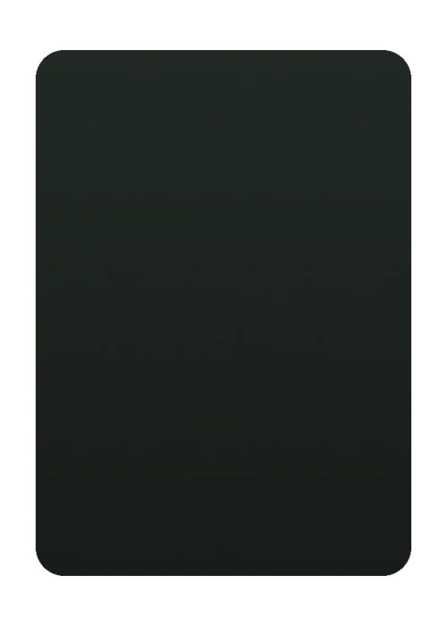 | [Padrão](./padrao/README.md) | — | todos (carta base) | — | no app |
| 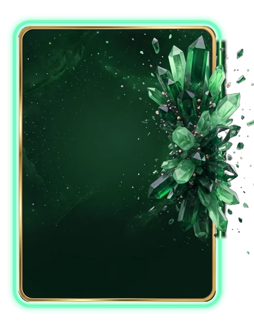 | [Esmeralda](./esmeralda/README.md) | Épica | Loja (grátis, prêmio do primeiro login) | — | no app |
| 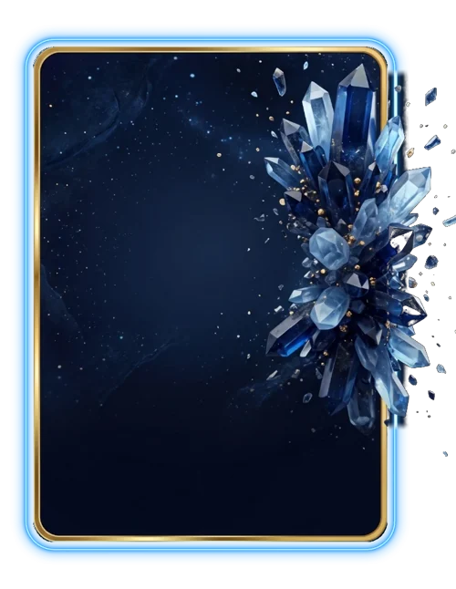 | [Safira](./safira/README.md) | Épica | Loja | — | no app |
| 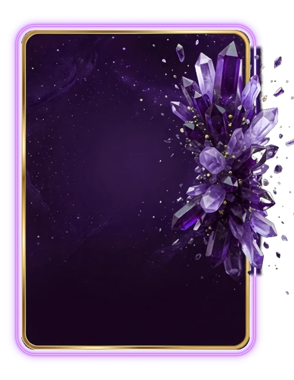 | [Ametista](./ametista/README.md) | Épica | Loja | — | no app |
| 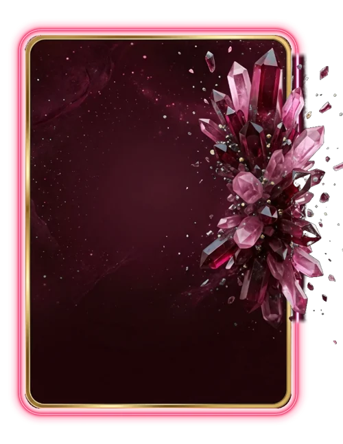 | [Rubi](./rubi/README.md) | Épica | Loja | — | no app |
| 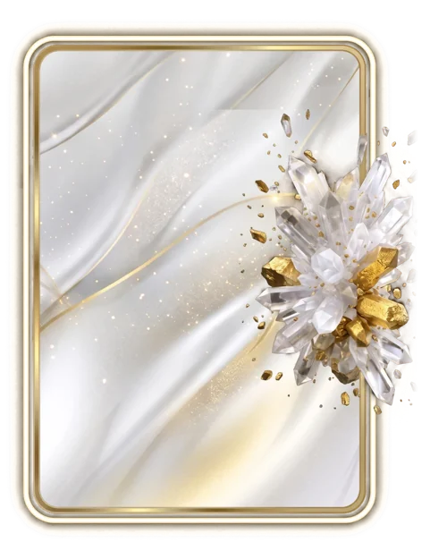 | [Ícone](./icone/README.md) | Épica | Loja | — | no app |
| 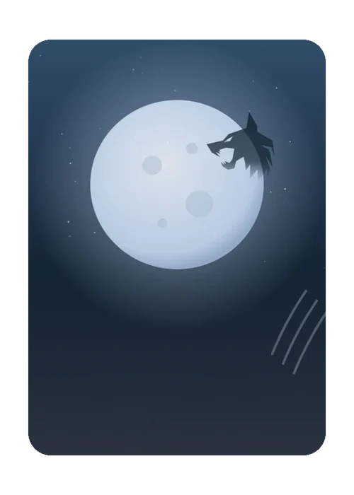 | [Lobisomem](./lobisomem/README.md) | Rara | Loja (evento) | Halloween 2026 (01/10 a 30/10) | saiu do app |
| 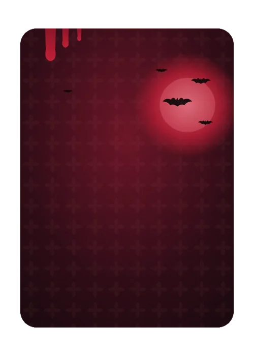 | [Vampiro](./vampiro/README.md) | Rara | Loja (evento) | Halloween 2026 (01/10 a 30/10) | saiu do app |
| 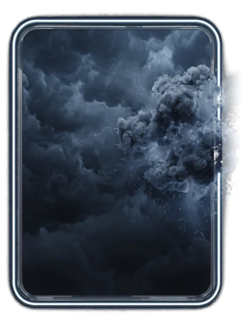 | [Nuvem carregada](./nuvem/README.md) | Épica | Pacote (era Loja) | Toró (novembro de 2026) | no app |
| 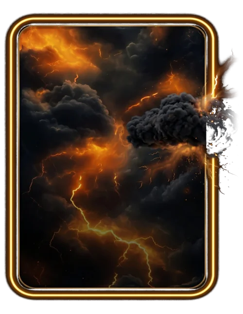 | [Relâmpago](./relampago/README.md) | Épica | Pacote (era Loja) | Toró (novembro de 2026) | no app |
| 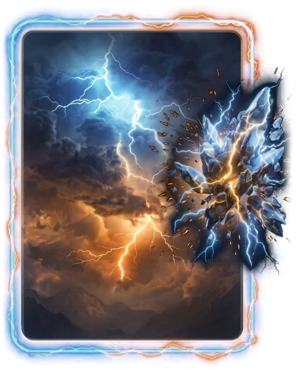 | [Lenda do Trovão](./lenda/README.md) | Épica | Pacote (era Loja) | Toró (novembro de 2026) | no app |
| 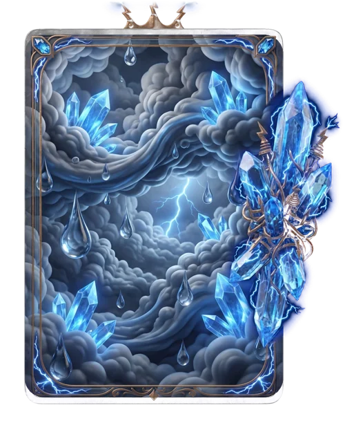 | [Dilúvio](./diluvio/README.md) | Lendária | Pacote | Toró (novembro de 2026) | no app |
| 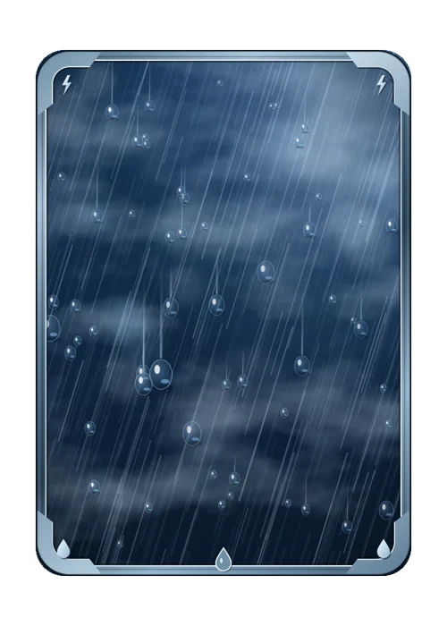 | [Aguaceiro](./aguaceiro/README.md) | Rara | Pacote | Toró (novembro de 2026) | no app |
| 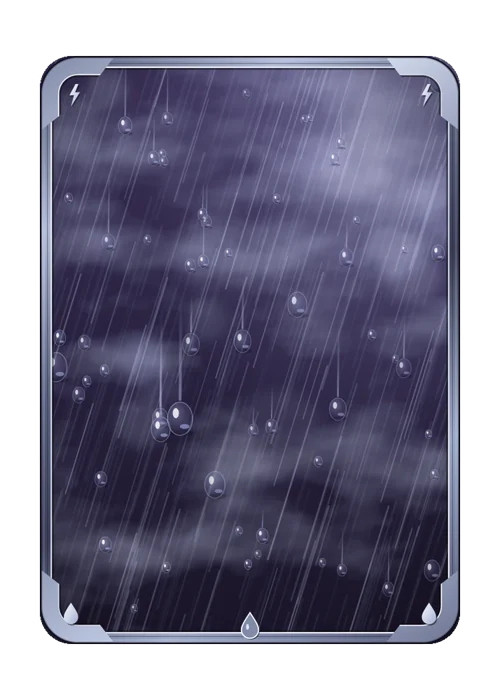 | [Chuva Violeta](./chuvavioleta/README.md) | Rara | Pacote | Toró (novembro de 2026) | no app |
| 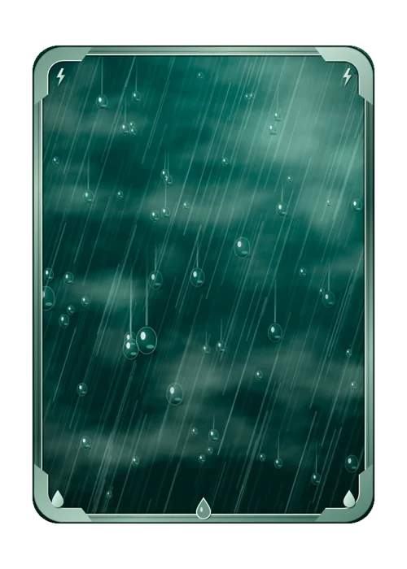 | [Chuva Esmeralda](./chuvaesmeralda/README.md) | Rara | Pacote | Toró (novembro de 2026) | no app |
| 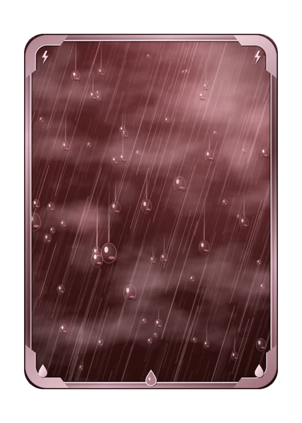 | [Chuva Rubi](./chuvarubi/README.md) | Rara | Pacote | Toró (novembro de 2026) | no app |
| 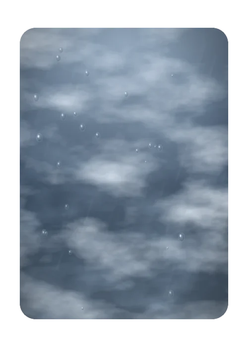 | [Nublado](./nublado/README.md) | Comum | Pacote | Toró (novembro de 2026) | no app |
| 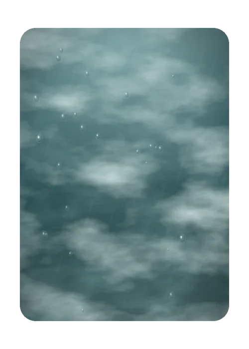 | [Neblina](./neblina/README.md) | Comum | Pacote | Toró (novembro de 2026) | no app |
| 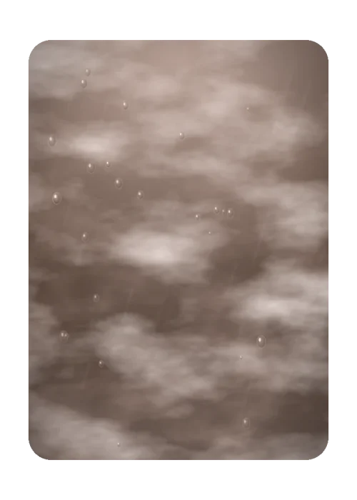 | [Cerração](./cerracao/README.md) | Comum | Pacote | Toró (novembro de 2026) | no app |
| 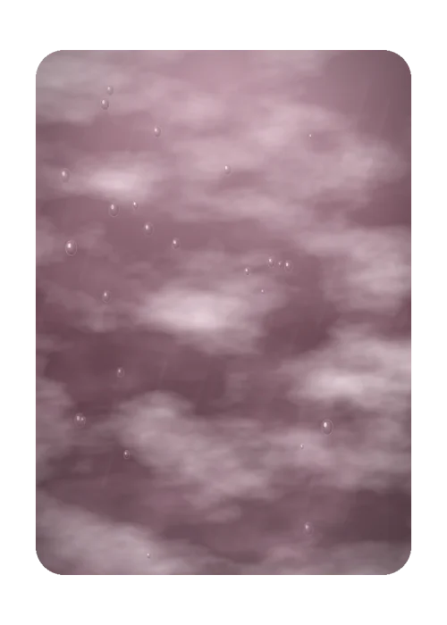 | [Crepúsculo](./crepusculo/README.md) | Comum | Pacote | Toró (novembro de 2026) | no app |
| 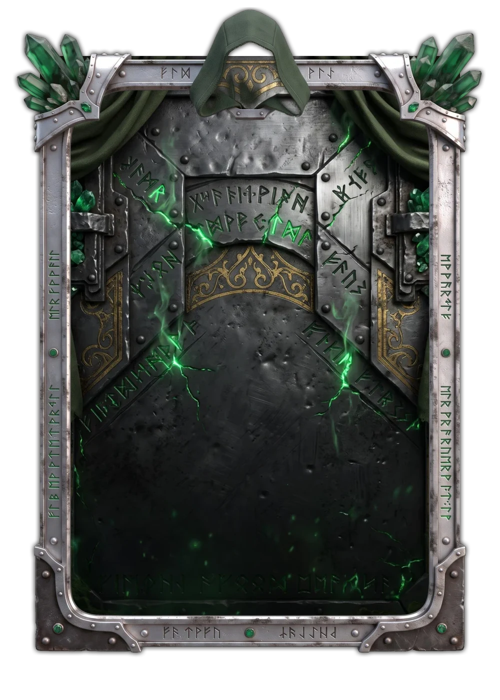 | [Destino](./destino/README.md) | Lendária | Pacote (evento Destino) | Destino (dezembro de 2026) | no app |
| 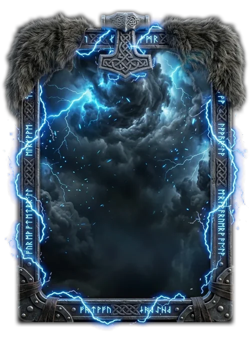 | [Tormenta](./tormenta/README.md) | Lendária | Pacote (evento Destino) | Destino (dezembro de 2026) | no app |
| 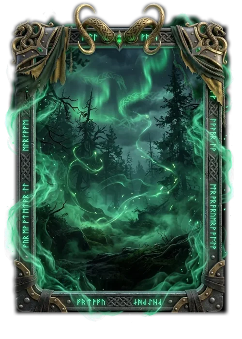 | [Embuste](./embuste/README.md) | Lendária | Pacote (evento Destino) | Destino (dezembro de 2026) | no app |
| 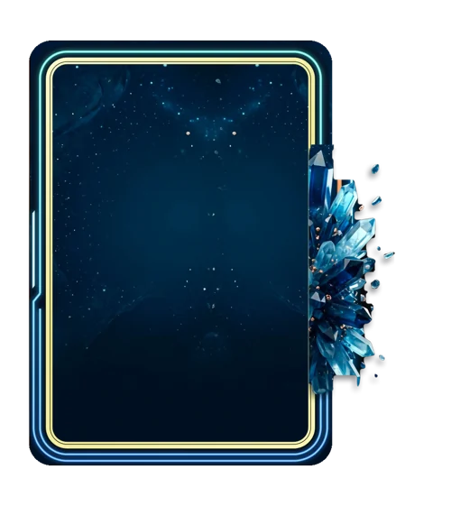 | [Voltagem](./voltagem/README.md) | — | nenhum | — | guardada |
| 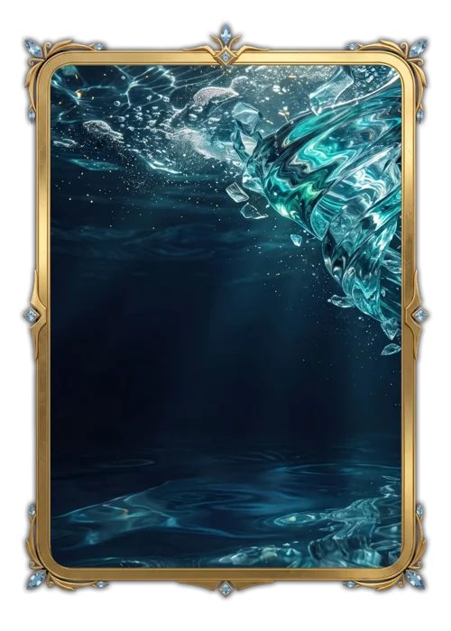 | [Maré](./mare/README.md) | — | nenhum | — | guardada |
| 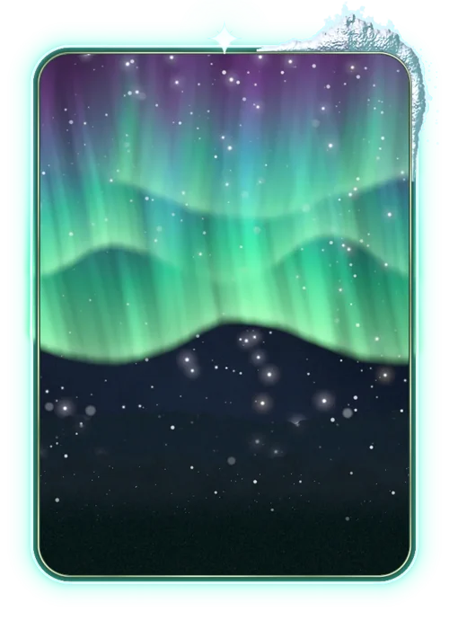 | [Aurora](./aurora/README.md) | — | nenhum | — | guardada |

## Visuais de prêmio (10)

| | Carta | Raridade | Onde | Evento | Estado |
| --- | --- | --- | --- | --- | --- |
| 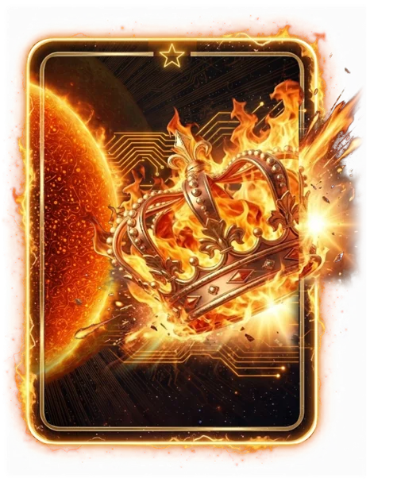 | [Melhor Jogador (fora de evento e Toró)](./premio-craque/README.md) | — | prêmio da rodada | fora de evento e Toró | no app |
| 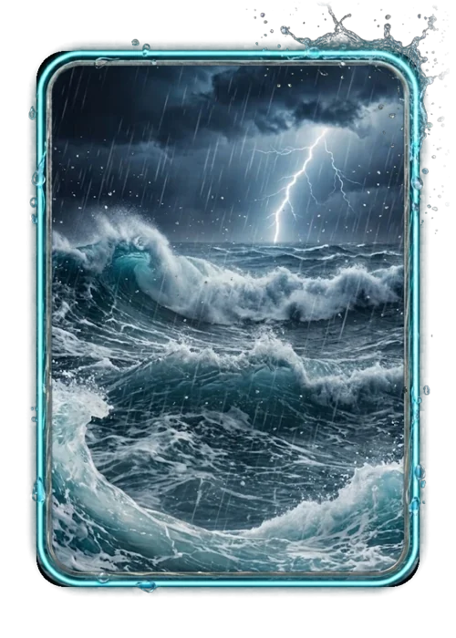 | [Destaques da rodada (fora de evento)](./premio-destaques/README.md) | — | prêmio da rodada (Atacante, Criativo, Defensor, Goleiro, Gol, Goleador) | fora de evento | no app |
| 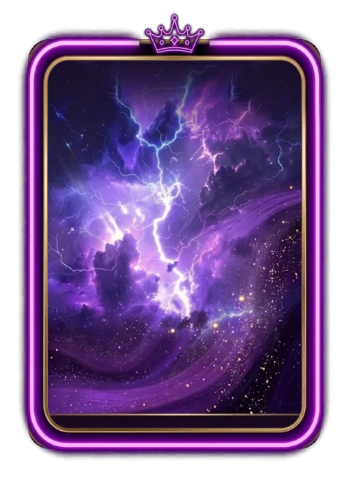 | [Time do Mês](./premio-time-do-mes/README.md) | — | prêmio do mês | — | no app |
| 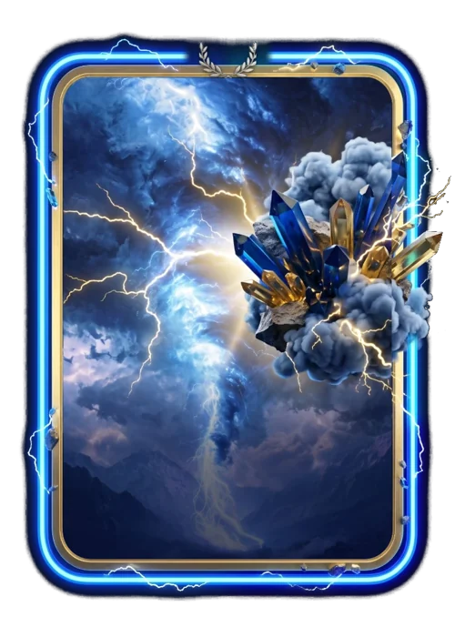 | [Campeão do Mês](./premio-campeao-do-mes/README.md) | — | prêmio do mês (1º do ranking) | — | no app |
| 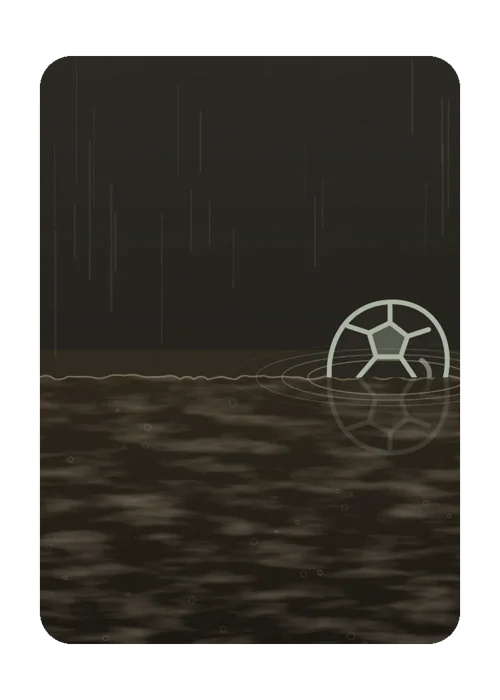 | [Bola Murcha](./premio-bola-murcha/README.md) | — | prêmio da rodada (zoeira) | — | no app |
| 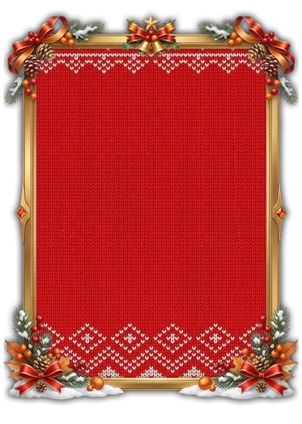 | [Natal: carta-base dos prêmios (vermelha)](./natal-craque/README.md) | — | todos os prêmios individuais de dezembro em diante | Natal (dezembro de 2026) | guardada |
| 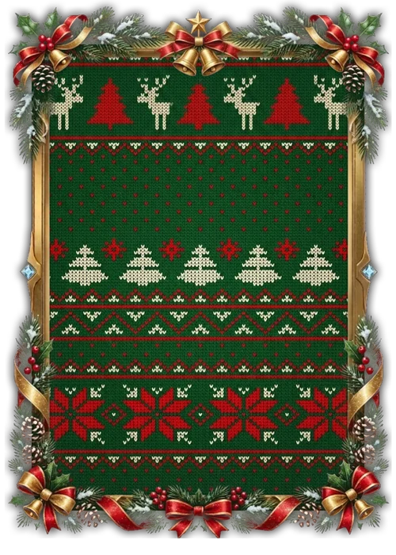 | [Natal: Campeão do Mês (verde)](./natal-campeao/README.md) | — | Campeão do Mês de dezembro | Natal (dezembro de 2026) | guardada |
| 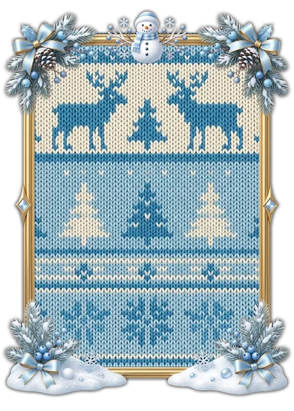 | [Natal: destaques (azul-gelo)](./natal-gelo/README.md) | — | destaques de dezembro | Natal (dezembro de 2026) | guardada |
| 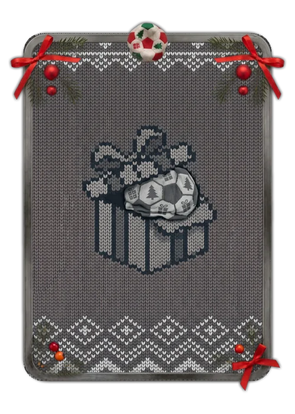 | [Natal: Bola Murcha (cinza-carvão)](./natal-murcha/README.md) | — | Bola Murcha de dezembro | Natal (dezembro de 2026) | guardada |
| 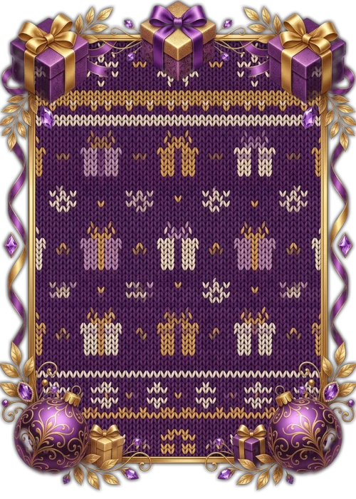 | [Natal: Time do Mês (roxa)](./natal-timedomes/README.md) | — | Time do Mês de dezembro | Natal (dezembro de 2026) | guardada |

## Em andamento

- **2026-11-11**: Nova regra de raridade pela borda registrada; as próximas cartas (dezembro) já seguem ela.
- **2026-11-11**: Cartas em 3D no Blender: Destino aprovada (branch feat/carta-3d-teste, scripts/blender/carta-3d.py), falta ligar no app; foto e números ao vivo entre a camada do fundo e a da moldura.
- **2026-11-08**: Pacotes de skins (conjunto de novembro: 12 skins, 6 desenhos) ainda desligados nas peladas; lançamento planejado para 1/12.

## Próximos

- **2026-12**: Conjunto de pacotes de dezembro (tema Destino): skins e raridades a definir com o dono; lendárias já prontas: Destino, Tormenta, Embuste.
- **2026-12**: Ligar o tema de Natal dos prêmios (carta-base vermelha com medalhão; Bola Murcha cinza-carvão).
- **2026-12**: Cartas novas já nascem peça por peça (fundo, borda, enfeites, renders, flutuantes) e em 3D no Blender.
- **futuro**: Refazer a Dilúvio em 3D (tem todas as peças separadas).
- **futuro**: Representação da raridade fora da Loja e de Eu (Início, Carreira, mesa tática, ranking): a definir pelo dono.

Linha do tempo completa: [LINHA-DO-TEMPO.md](LINHA-DO-TEMPO.md).
