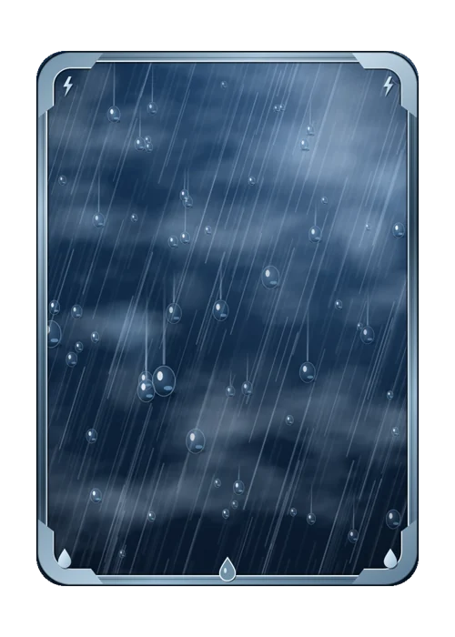

# Aguaceiro

> Ficha gerada de `docs/cartas/catalogo.json` por `scripts/cartas/gerar-catalogo.py`. Edite o JSON, não este arquivo.

| | |
| --- | --- |
| Chave | `aguaceiro` |
| Tipo | skin |
| Raridade | Rara |
| Onde aparece | Pacote |
| Evento | Toró (novembro de 2026) |
| Nível e preço | — |
| Estado | no app |
| Roupa no código | `aguaceiro` em `components/cancha-card.tsx` |

## Montada

## Arquivos no app (`public/cartas/fundos/`)

- Fundo: `premium-aguaceiro.webp`
- Moldura e o que vaza: `premium-aguaceiro-vaza.webp`

## Peças originais (do Gemini, como o dono mandou)

- nenhuma separada (feita em código ou arte achatada)

## Scripts

- `docs/superpowers/specs/2026-10-28-cartas-assets/prototipos/aguaceiro.cjs`

## Histórico

- **2026-11-08**: feita em código por Claude

## Notas

Desenho base das cores Chuva Violeta, Esmeralda e Rubi.
