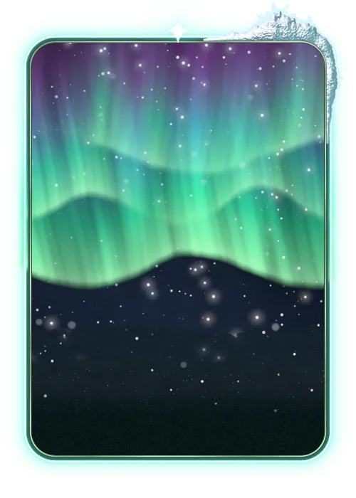

# Aurora

> Ficha gerada de `docs/cartas/catalogo.json` por `scripts/cartas/gerar-catalogo.py`. Edite o JSON, não este arquivo.

| | |
| --- | --- |
| Chave | `aurora` |
| Tipo | skin |
| Raridade | — |
| Onde aparece | nenhum |
| Evento | — |
| Nível e preço | — |
| Estado | guardada |
| Roupa no código | `auroraBoreal` em `components/cancha-card.tsx` |

## Montada

## Arquivos no app (`public/cartas/fundos/`)

- Fundo: `premium-aurora.webp`
- Moldura e o que vaza: `premium-aurora-vaza.webp`

## Peças originais (do Gemini, como o dono mandou)

- nenhuma separada (feita em código ou arte achatada)

## Scripts

- `docs/superpowers/specs/2026-10-28-cartas-assets/prototipos/premium-aurora.cjs`

## Histórico

- **2026-11-04**: aprovada, feita só em código (aurora, neve vazando); não ligada

## Notas

Ver docs/calendario-eventos.md, seção Carta guardada: Aurora.
