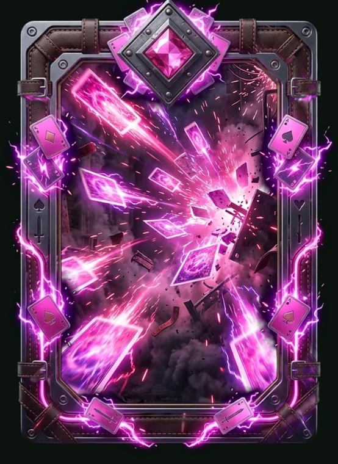

# Cartada

> Ficha gerada de `docs/cartas/catalogo.json` por `scripts/cartas/gerar-catalogo.py`. Edite o JSON, não este arquivo.

| | |
| --- | --- |
| Chave | `cartada` |
| Tipo | skin |
| Raridade | Épica |
| Onde aparece | Pacote |
| Evento | Destino (dezembro de 2026) |
| Nível e preço | — |
| Estado | guardada |
| Roupa no código | — |

## Montada

## Arquivos no app (`public/cartas/fundos/`)

## Peças originais (do Gemini, como o dono mandou)

- `docs/cartas/cartada/pecas/fundo.webp`
- `docs/cartas/cartada/pecas/borda.webp`
- `docs/cartas/cartada/pecas/borda-com-emblema.webp`

## Scripts

- —

## Histórico

- **2026-11-12**: peças recebidas do Gemini
- **2026-11-12**: borda refeita no Gemini sem o emblema do topo, com enfeite próprio

## Notas

cartas de baralho explodindo em energia rosa; moldura de metal escuro com neon rosa e raios. Nome e evento confirmados pelo dono em 2026-11-12. Peças antigas guardadas com sufixo (-com-emblema, -antigo), não usar. Prévia: scripts/cartas/previa-pecas.py.
