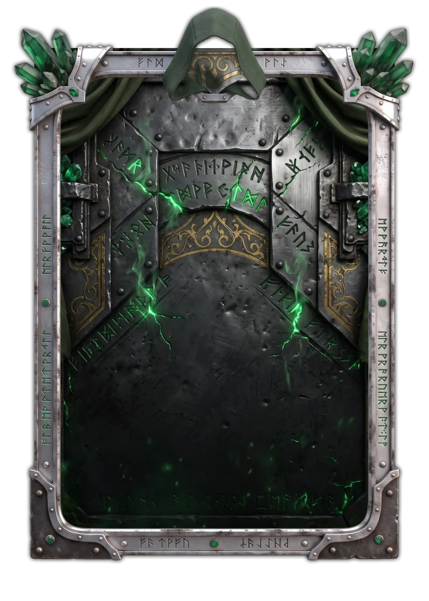
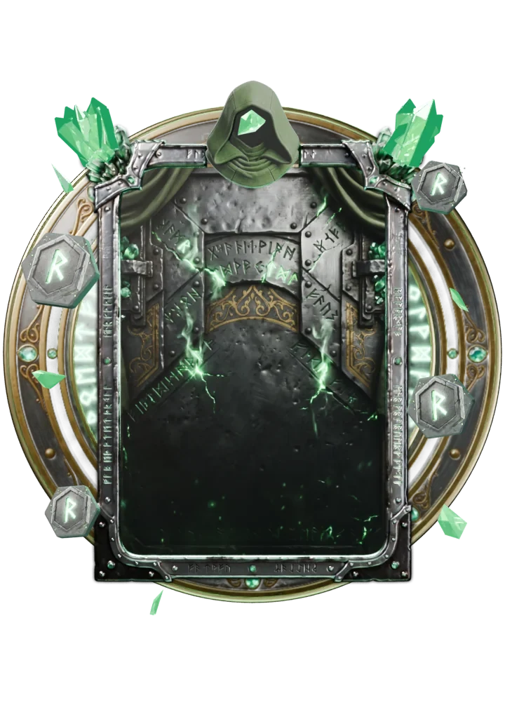

# Destino

> Ficha gerada de `docs/cartas/catalogo.json` por `scripts/cartas/gerar-catalogo.py`. Edite o JSON, não este arquivo.

| | |
| --- | --- |
| Chave | `destino` |
| Tipo | skin |
| Raridade | Lendária |
| Onde aparece | Pacote (evento Destino) |
| Evento | Destino (dezembro de 2026) |
| Nível e preço | nível 5, 600 CC |
| Estado | no app |
| Roupa no código | `destino` em `components/cancha-card.tsx` |

## Montada

## Arquivos no app (`public/cartas/fundos/`)

- Fundo: `premium-destino.webp`
- Moldura e o que vaza: `premium-destino-vaza.webp`
- Flutuantes: `DESTINO_FLOATERS (círculo arcano, runas, cacos)`

## Peças originais (do Gemini, como o dono mandou)

- `docs/cartas/destino/pecas/fundo.jpg`
- `docs/cartas/destino/pecas/borda.jpg`
- `docs/cartas/destino/pecas/enfeite-capuz-3d.jpg`
- `docs/cartas/destino/pecas/flutuante-circulo-arcano.jpg`
- `docs/cartas/destino/pecas/flutuante-runa-pedra.jpg`
- `docs/cartas/destino/pecas/flutuante-cacos-esmeralda.jpg`

## Scripts

- `docs/superpowers/specs/2026-10-28-cartas-assets/prototipos/montar-carta.cjs`
- `docs/superpowers/specs/2026-10-28-cartas-assets/prototipos/destino-runas.cjs`
- `scripts/blender/carta-3d.py`

## Histórico

- **2026-11-05**: montada e guardada (2D), alusão a vilão de capuz verde sem copiar traje
- **2026-11-05**: runas e cacos flutuando, círculo arcano girando
- **2026-11-11**: versão 3D no Blender aprovada pelo dono (capuz 3D dele no topo); ainda não ligada no app

## Notas

Padrão de lendária. Na Loja de 1 a 31/12/2026 (hoje só de pacote).
