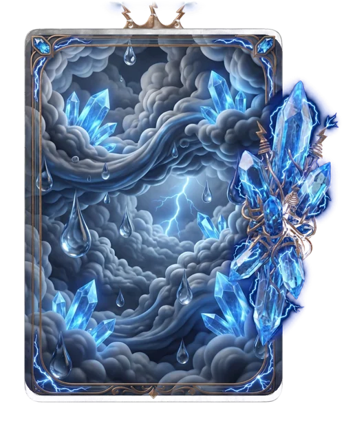

# Dilúvio

> Ficha gerada de `docs/cartas/catalogo.json` por `scripts/cartas/gerar-catalogo.py`. Edite o JSON, não este arquivo.

| | |
| --- | --- |
| Chave | `diluvio` |
| Tipo | skin |
| Raridade | Lendária |
| Onde aparece | Pacote |
| Evento | Toró (novembro de 2026) |
| Nível e preço | — |
| Estado | no app |
| Roupa no código | `diluvio` em `components/cancha-card.tsx` |

## Montada

## Arquivos no app (`public/cartas/fundos/`)

- Fundo: `premium-diluvio.webp`
- Moldura e o que vaza: `premium-diluvio-vaza.webp`
- Flutuantes: `DILUVIO_FLOATERS (anel, gotas, cacos)`

## Peças originais (do Gemini, como o dono mandou)

- `docs/superpowers/specs/2026-10-28-cartas-assets/prototipos/diluvio-fundo-dono.jpg`
- `docs/superpowers/specs/2026-10-28-cartas-assets/prototipos/diluvio-borda-dono.jpg`
- `docs/superpowers/specs/2026-10-28-cartas-assets/prototipos/diluvio-render-dono.jpg`
- `docs/superpowers/specs/2026-10-28-cartas-assets/prototipos/diluvio-anel-dono.jpg`
- `docs/superpowers/specs/2026-10-28-cartas-assets/prototipos/diluvio-gotas-dono.jpg`
- `docs/superpowers/specs/2026-10-28-cartas-assets/prototipos/diluvio-cacos-dono.jpg`

## Scripts

- `docs/superpowers/specs/2026-10-28-cartas-assets/prototipos/diluvio-v1.cjs`
- `docs/superpowers/specs/2026-10-28-cartas-assets/prototipos/diluvio-flutuantes.cjs`

## Histórico

- **2026-11-08**: lendária do conjunto de novembro, peças do dono no Gemini
- **2026-11-11**: teste 3D no Blender: "quase aceitável", mas mantida como está

## Notas

Única de novembro com todas as peças separadas: candidata a refazer em 3D depois.
