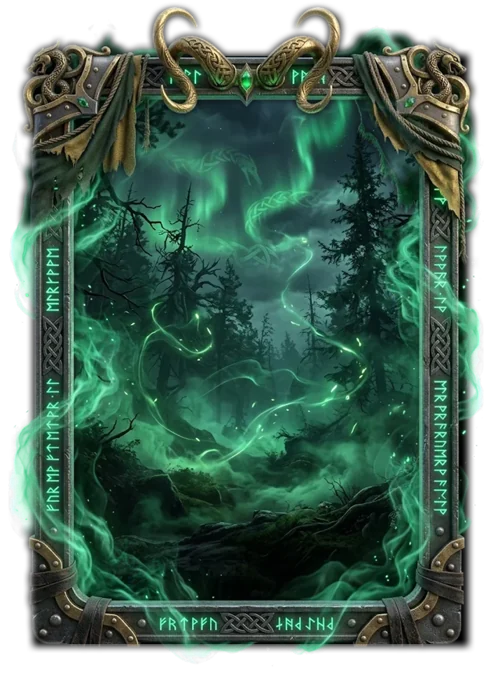

# Embuste

> Ficha gerada de `docs/cartas/catalogo.json` por `scripts/cartas/gerar-catalogo.py`. Edite o JSON, não este arquivo.

| | |
| --- | --- |
| Chave | `embuste` |
| Tipo | skin |
| Raridade | Lendária |
| Onde aparece | Pacote (evento Destino) |
| Evento | Destino (dezembro de 2026) |
| Nível e preço | nível 5, 600 CC |
| Estado | no app |
| Roupa no código | `embuste` em `components/cancha-card.tsx` |

## Montada

## Arquivos no app (`public/cartas/fundos/`)

- Fundo: `premium-embuste.webp`
- Moldura e o que vaza: `premium-embuste-vaza.webp`
- Flutuantes: `EMBUSTE_FLOATERS`

## Peças originais (do Gemini, como o dono mandou)

- `docs/superpowers/specs/2026-10-28-cartas-assets/prototipos/embuste-fundo-dono.webp`
- `docs/superpowers/specs/2026-10-28-cartas-assets/prototipos/embuste-borda-dono.webp`
- `docs/superpowers/specs/2026-10-28-cartas-assets/prototipos/embuste-pecas-dono.jpg`

## Scripts

- `docs/superpowers/specs/2026-10-28-cartas-assets/prototipos/montar-carta.cjs`
- `docs/superpowers/specs/2026-10-28-cartas-assets/prototipos/embuste-borda.cjs`
- `docs/superpowers/specs/2026-10-28-cartas-assets/prototipos/embuste-pecas.cjs`

## Histórico

- **2026-11-09**: floresta sob aurora verde, moldura de ferro com chifres e dragões; fumaça girando, rochas, runas e adaga

## Notas

statsLift 5.
