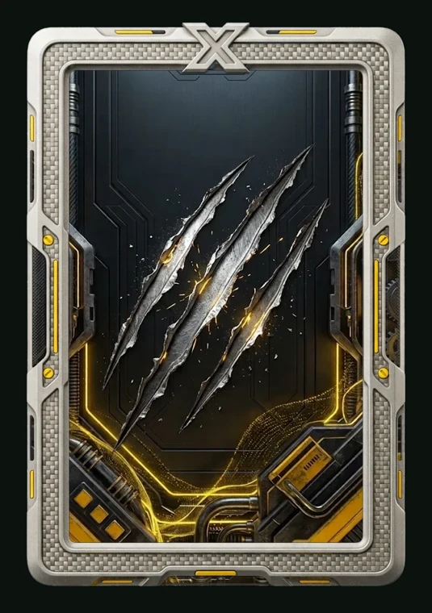

# Garra

> Ficha gerada de `docs/cartas/catalogo.json` por `scripts/cartas/gerar-catalogo.py`. Edite o JSON, não este arquivo.

| | |
| --- | --- |
| Chave | `garra` |
| Tipo | skin |
| Raridade | Épica |
| Onde aparece | Pacote |
| Evento | Destino (dezembro de 2026) |
| Nível e preço | — |
| Estado | guardada |
| Roupa no código | — |

## Montada

## Arquivos no app (`public/cartas/fundos/`)

## Peças originais (do Gemini, como o dono mandou)

- `docs/cartas/garra/pecas/fundo.webp`
- `docs/cartas/garra/pecas/borda.webp`
- `docs/cartas/garra/pecas/borda-com-emblema.webp`
- `docs/cartas/garra/pecas/fundo-antigo.webp`

## Scripts

- —

## Histórico

- **2026-11-12**: peças recebidas do Gemini
- **2026-11-12**: borda refeita no Gemini sem o emblema do topo, com enfeite próprio; fundo refeito sem a moldura de dentro (sobra um contorno leve, coberto pela borda)
- **2026-11-12**: aprovada pelo dono como épica; prévia no tamanho padrão (5:7 nos 84% do meio)

## Notas

painel escuro com três cortes de garra e circuitos dourados; moldura de metal prateado com detalhes amarelos. Nome e evento confirmados pelo dono em 2026-11-12. Peças antigas guardadas com sufixo (-com-emblema, -antigo), não usar. Prévia: scripts/cartas/previa-pecas.py.
