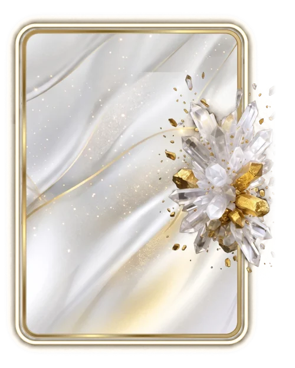

# Ícone

> Ficha gerada de `docs/cartas/catalogo.json` por `scripts/cartas/gerar-catalogo.py`. Edite o JSON, não este arquivo.

| | |
| --- | --- |
| Chave | `icone` |
| Tipo | skin |
| Raridade | Épica |
| Onde aparece | Loja |
| Evento | — |
| Nível e preço | nível 11, 1200 CC |
| Estado | no app |
| Roupa no código | `icone` em `components/cancha-card.tsx` |

## Montada

## Arquivos no app (`public/cartas/fundos/`)

- Fundo: `premium-marfim.webp`
- Moldura e o que vaza: `premium-marfim-vaza.webp`

## Peças originais (do Gemini, como o dono mandou)

- `docs/superpowers/specs/2026-10-28-cartas-assets/prototipos/icone-v4-fundo-dono.jpg`
- `docs/superpowers/specs/2026-10-28-cartas-assets/prototipos/icone-v4-borda-dono.jpg`
- `docs/superpowers/specs/2026-10-28-cartas-assets/prototipos/icone-v4-render-dono.jpg`
- `docs/superpowers/specs/2026-10-28-cartas-assets/prototipos/icone-v3-fundo-dono.jpg`
- `docs/superpowers/specs/2026-10-28-cartas-assets/prototipos/icone-v3-render-dono.jpg`
- `docs/superpowers/specs/2026-10-28-cartas-assets/prototipos/icone-v3-composto-dono.jpg`
- `docs/superpowers/specs/2026-10-28-cartas-assets/prototipos/premium-icone-dono.jpg`

## Scripts

- `docs/superpowers/specs/2026-10-28-cartas-assets/prototipos/icone-v4.cjs`
- `docs/superpowers/specs/2026-10-28-cartas-assets/prototipos/icone-v3.cjs`
- `docs/superpowers/specs/2026-10-28-cartas-assets/prototipos/premium-icone.cjs`

## Histórico

- **2026-11-01**: mármore, quartzo e diamantes do Gemini (clean)
- **2026-11-01**: desceu do nível 16 para o 11
- **2026-11-05**: moldura fina de louros com diamantes (guardada em premium-icone-fino)
- **2026-11-09**: versão 4: cetim branco com veios de ouro, moldura de ouro com fio de luz, cristais com pepitas (3 peças próprias)
- **2026-11-11**: mantida com o que vaza; pela nova regra, as cartas novas não terão peça saindo da carta

## Notas

Carta clara: ink escuro na roupa. Render reduzido a 70% e na lateral direita, meio dentro e meio fora.
