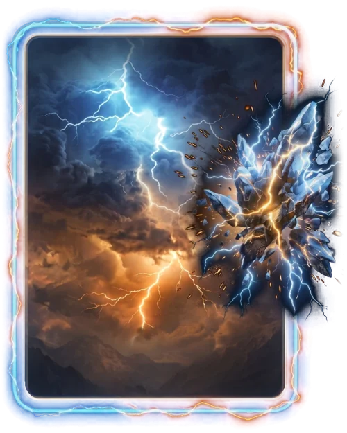

# Lenda do Trovão

> Ficha gerada de `docs/cartas/catalogo.json` por `scripts/cartas/gerar-catalogo.py`. Edite o JSON, não este arquivo.

| | |
| --- | --- |
| Chave | `lenda` |
| Tipo | skin |
| Raridade | Épica |
| Onde aparece | Pacote (era Loja) |
| Evento | Toró (novembro de 2026) |
| Nível e preço | nível 5, 600 CC |
| Estado | no app |
| Roupa no código | `lenda` em `components/cancha-card.tsx` |

## Montada

## Arquivos no app (`public/cartas/fundos/`)

- Fundo: `skin-lenda.webp`
- Moldura e o que vaza: `skin-lenda-vaza.webp`
- Raios que acendem: `skin-lenda-raios-dentro.webp`, `skin-lenda-raios.webp`

## Peças originais (do Gemini, como o dono mandou)

- `docs/superpowers/specs/2026-10-28-cartas-assets/prototipos/lenda-v5-fundo-dono.jpg`
- `docs/superpowers/specs/2026-10-28-cartas-assets/prototipos/lenda-v5-borda-dono.jpg`
- `docs/superpowers/specs/2026-10-28-cartas-assets/prototipos/lenda-v5-render-dono.jpg`
- `docs/superpowers/specs/2026-10-28-cartas-assets/prototipos/lenda-v2-fundo-dono.jpg`
- `docs/superpowers/specs/2026-10-28-cartas-assets/prototipos/lenda-v2-moldura-dono.jpg`
- `docs/superpowers/specs/2026-10-28-cartas-assets/prototipos/lenda-v2-raios-dono.jpg`
- `docs/superpowers/specs/2026-10-28-cartas-assets/prototipos/lenda-concept-dono.jpg`
- `docs/superpowers/specs/2026-10-28-cartas-assets/prototipos/lenda-fundo-dono.jpg`

## Scripts

- `docs/superpowers/specs/2026-10-28-cartas-assets/prototipos/skin-lenda-v5.cjs`

## Histórico

- **2026-10-31**: carta de prestígio do Toró (nível 5)
- **2026-11-02**: versão 5 em camadas do Gemini (fundo, borda, render do cristal de rocha) + animação só nos raios
- **2026-11-11**: virou só de pacote
- **2026-11-11**: teste 3D no Blender recusado; fica como está

## Notas

Tem peças separadas (v5), mas o render do cristal veio com a moldura no mesmo lugar; refazer em 3D exigiria o cristal sozinho.
