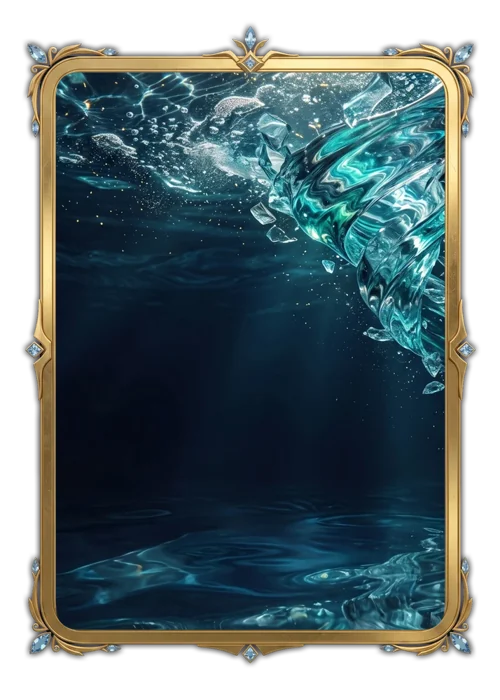

# Maré

> Ficha gerada de `docs/cartas/catalogo.json` por `scripts/cartas/gerar-catalogo.py`. Edite o JSON, não este arquivo.

| | |
| --- | --- |
| Chave | `mare` |
| Tipo | skin |
| Raridade | — |
| Onde aparece | nenhum |
| Evento | — |
| Nível e preço | — |
| Estado | guardada |
| Roupa no código | `mare` em `components/cancha-card.tsx` |

## Montada

## Arquivos no app (`public/cartas/fundos/`)

- Fundo: `premium-mare.webp`
- Moldura e o que vaza: `premium-mare-vaza.webp`

## Peças originais (do Gemini, como o dono mandou)

- nenhuma separada (feita em código ou arte achatada)

## Scripts

- —

## Histórico

- **2026-11-05**: guardada: moldura de ouro fina e água abstrata
