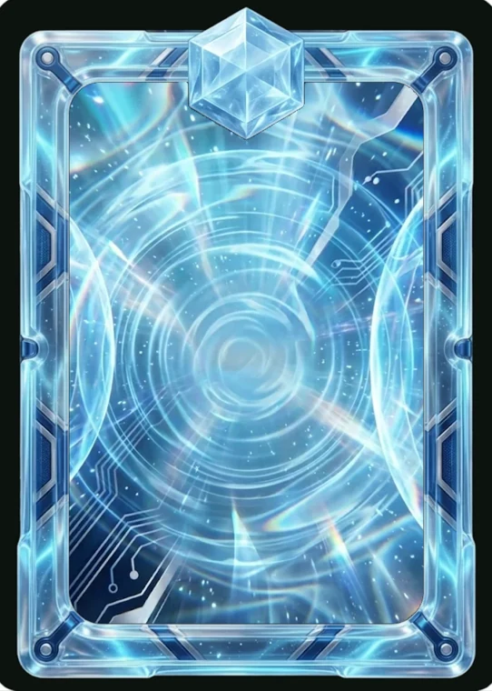

# Miragem

> Ficha gerada de `docs/cartas/catalogo.json` por `scripts/cartas/gerar-catalogo.py`. Edite o JSON, não este arquivo.

| | |
| --- | --- |
| Chave | `miragem` |
| Tipo | skin |
| Raridade | Épica |
| Onde aparece | Pacote |
| Evento | Destino (dezembro de 2026) |
| Nível e preço | — |
| Estado | guardada |
| Roupa no código | — |

## Montada

## Arquivos no app (`public/cartas/fundos/`)

## Peças originais (do Gemini, como o dono mandou)

- `docs/cartas/miragem/pecas/fundo.webp`
- `docs/cartas/miragem/pecas/borda.webp`

## Scripts

- —

## Histórico

- **2026-11-12**: peças recebidas do Gemini

## Notas

campo de força azul-gelo translúcido; moldura de vidro azul. Nome provisório (a confirmar com o dono). A borda tem um emblema de super-herói no topo: trocar antes de ligar (só alusões, sem marca). Prévia: scripts/cartas/previa-pecas.py.
