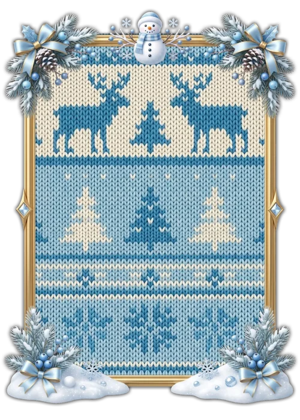

# Natal: destaques (azul-gelo)

> Ficha gerada de `docs/cartas/catalogo.json` por `scripts/cartas/gerar-catalogo.py`. Edite o JSON, não este arquivo.

| | |
| --- | --- |
| Chave | `natal-gelo` |
| Tipo | visual de prêmio |
| Raridade | — |
| Onde aparece | destaques de dezembro |
| Evento | Natal (dezembro de 2026) |
| Nível e preço | — |
| Estado | guardada |
| Roupa no código | `natalGelo` em `components/cancha-card.tsx` |

## Montada

## Arquivos no app (`public/cartas/fundos/`)

- Fundo: `premium-natal-gelo.webp`
- Moldura e o que vaza: `premium-natal-gelo-vaza.webp`

## Peças originais (do Gemini, como o dono mandou)

- `docs/superpowers/specs/2026-10-28-cartas-assets/prototipos/natal-gelo-fundo-dono.jpg`
- `docs/superpowers/specs/2026-10-28-cartas-assets/prototipos/natal-gelo-borda-dono.jpg`

## Scripts

- `docs/superpowers/specs/2026-10-28-cartas-assets/prototipos/montar-carta.cjs`

## Histórico

- **2026-11-05**: guardada

## Notas

Com a carta-base única (2026-11-09) pode não ser usada.
