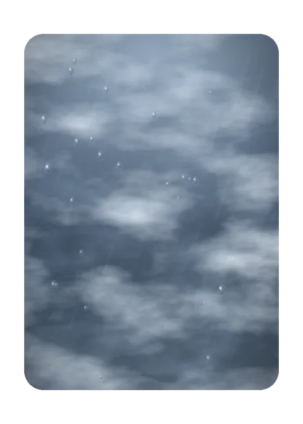

# Nublado

> Ficha gerada de `docs/cartas/catalogo.json` por `scripts/cartas/gerar-catalogo.py`. Edite o JSON, não este arquivo.

| | |
| --- | --- |
| Chave | `nublado` |
| Tipo | skin |
| Raridade | Comum |
| Onde aparece | Pacote |
| Evento | Toró (novembro de 2026) |
| Nível e preço | — |
| Estado | no app |
| Roupa no código | `nublado` em `components/cancha-card.tsx` |

## Montada

## Arquivos no app (`public/cartas/fundos/`)

- Fundo: `skin-nublado.webp`

## Peças originais (do Gemini, como o dono mandou)

- nenhuma separada (feita em código ou arte achatada)

## Scripts

- `docs/superpowers/specs/2026-10-28-cartas-assets/prototipos/nublado.cjs`

## Histórico

- **2026-11-08**: feita em código por Claude

## Notas

Borda simples em código. Desenho base de Neblina, Cerração e Crepúsculo.
