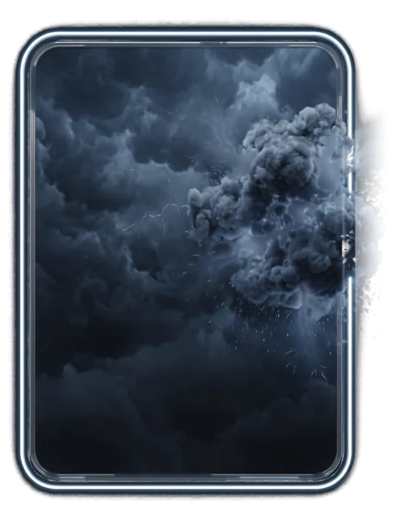

# Nuvem carregada

> Ficha gerada de `docs/cartas/catalogo.json` por `scripts/cartas/gerar-catalogo.py`. Edite o JSON, não este arquivo.

| | |
| --- | --- |
| Chave | `nuvem` |
| Tipo | skin |
| Raridade | Épica |
| Onde aparece | Pacote (era Loja) |
| Evento | Toró (novembro de 2026) |
| Nível e preço | nível 3, 200 CC |
| Estado | no app |
| Roupa no código | `nuvem` em `components/cancha-card.tsx` |

## Montada

## Arquivos no app (`public/cartas/fundos/`)

- Fundo: `premium-nuvem.webp`
- Moldura e o que vaza: `premium-nuvem-vaza.webp`
- Raios que acendem: `premium-nuvem-raios-dentro.webp`, `premium-nuvem-raios.webp`

## Peças originais (do Gemini, como o dono mandou)

- `docs/superpowers/specs/2026-10-28-cartas-assets/prototipos/premium-nuvem-dono.jpg`

## Scripts

- `docs/superpowers/specs/2026-10-28-cartas-assets/prototipos/premium-nuvem.cjs`

## Histórico

- **2026-10-31**: no lugar do Trovão roxo
- **2026-11-01**: arte de tempestade do Gemini; raios separados que acendem como trovão
- **2026-11-11**: virou só de pacote
- **2026-11-11**: teste 3D no Blender recusado: arte achatada (peça que vaza dentro da moldura); fica como está

## Notas

Arte numa imagem só (sem peças separadas).
