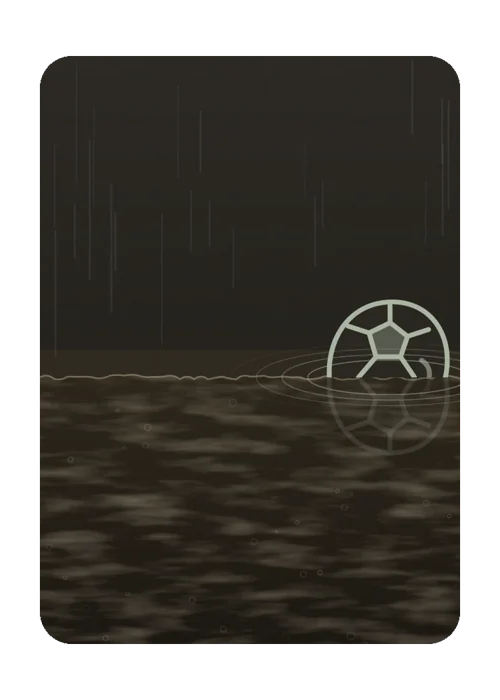

# Bola Murcha

> Ficha gerada de `docs/cartas/catalogo.json` por `scripts/cartas/gerar-catalogo.py`. Edite o JSON, não este arquivo.

| | |
| --- | --- |
| Chave | `premio-bola-murcha` |
| Tipo | visual de prêmio |
| Raridade | — |
| Onde aparece | prêmio da rodada (zoeira) |
| Evento | — |
| Nível e preço | — |
| Estado | no app |
| Roupa no código | `FLOP_ROUPA` em `components/cancha-card.tsx` |

## Montada

## Arquivos no app (`public/cartas/fundos/`)

- Fundo: `premio-bola-murcha.webp`

## Peças originais (do Gemini, como o dono mandou)

- nenhuma separada (feita em código ou arte achatada)

## Scripts

- `docs/superpowers/specs/2026-10-28-cartas-assets/prototipos/murcha.cjs`
- `docs/superpowers/specs/2026-10-28-cartas-assets/prototipos/murcha-alagamento.cjs`

## Histórico

- **2026-10-31**: novo desenho; as de outubro ficam em bronze oxidado

## Notas

Neon apagado.
