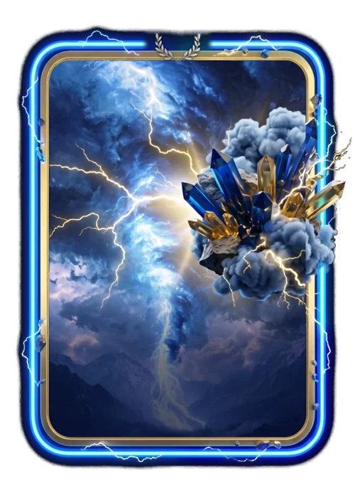

# Campeão do Mês

> Ficha gerada de `docs/cartas/catalogo.json` por `scripts/cartas/gerar-catalogo.py`. Edite o JSON, não este arquivo.

| | |
| --- | --- |
| Chave | `premio-campeao-do-mes` |
| Tipo | visual de prêmio |
| Raridade | — |
| Onde aparece | prêmio do mês (1º do ranking) |
| Evento | — |
| Nível e preço | — |
| Estado | no app |
| Roupa no código | `CAMPEAO_MES` em `components/cancha-card.tsx` |

## Montada

## Arquivos no app (`public/cartas/fundos/`)

- Fundo: `campeao-mes.webp`
- Moldura e o que vaza: `campeao-mes-vaza.webp`
- Raios que acendem: `campeao-mes-raios-dentro.webp`, `campeao-mes-raios.webp`

## Peças originais (do Gemini, como o dono mandou)

- `docs/superpowers/specs/2026-10-28-cartas-assets/prototipos/campeao-mes-dono.jpg`

## Scripts

- `docs/superpowers/specs/2026-10-28-cartas-assets/prototipos/campeao-mes.cjs`

## Histórico

- **2026-11-02**: tempestade azul e laranja, louro de platina, aglomerado vazando; raios acendendo
- **2026-11-04**: recorte refeito para ter o tamanho do Time do Mês
