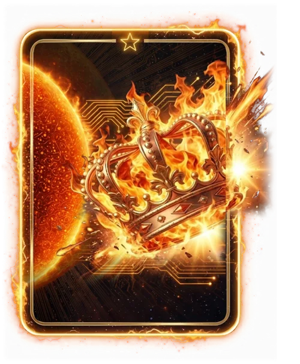

# Melhor Jogador (fora de evento e Toró)

> Ficha gerada de `docs/cartas/catalogo.json` por `scripts/cartas/gerar-catalogo.py`. Edite o JSON, não este arquivo.

| | |
| --- | --- |
| Chave | `premio-craque` |
| Tipo | visual de prêmio |
| Raridade | — |
| Onde aparece | prêmio da rodada |
| Evento | fora de evento e Toró |
| Nível e preço | — |
| Estado | no app |
| Roupa no código | `CRAQUE_FOGO` em `components/cancha-card.tsx` |

## Montada

## Arquivos no app (`public/cartas/fundos/`)

- Fundo: `premio-craque-fogo.webp`
- Moldura e o que vaza: `premio-craque-fogo-vaza.webp`

## Peças originais (do Gemini, como o dono mandou)

- `docs/superpowers/specs/2026-10-28-cartas-assets/prototipos/craque-fogo-fundo-dono.jpg`
- `docs/superpowers/specs/2026-10-28-cartas-assets/prototipos/craque-fogo-borda-dono.jpg`
- `docs/superpowers/specs/2026-10-28-cartas-assets/prototipos/craque-fogo-render-dono.jpg`

## Scripts

- `docs/superpowers/specs/2026-10-28-cartas-assets/prototipos/premio-craque-fogo.cjs`

## Histórico

- **2026-10-31**: sol art déco (premio-craque-default, hoje só na capa do pacote)
- **2026-11-02**: versão em camadas: sol com circuitos, neon dourado com fogo e coroa em chamas vazando

## Notas

Sem animação (a da coroa foi recusada).
