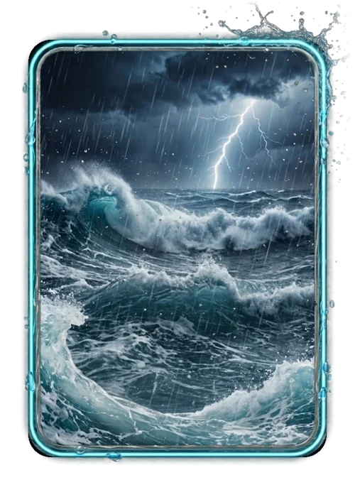

# Destaques da rodada (fora de evento)

> Ficha gerada de `docs/cartas/catalogo.json` por `scripts/cartas/gerar-catalogo.py`. Edite o JSON, não este arquivo.

| | |
| --- | --- |
| Chave | `premio-destaques` |
| Tipo | visual de prêmio |
| Raridade | — |
| Onde aparece | prêmio da rodada (Atacante, Criativo, Defensor, Goleiro, Gol, Goleador) |
| Evento | fora de evento |
| Nível e preço | — |
| Estado | no app |
| Roupa no código | `HIGHLIGHT_AGUA` em `components/cancha-card.tsx` |

## Montada

## Arquivos no app (`public/cartas/fundos/`)

- Fundo: `premio-destaque-mar.webp`
- Moldura e o que vaza: `premio-destaque-mar-vaza.webp`

## Peças originais (do Gemini, como o dono mandou)

- `docs/superpowers/specs/2026-10-28-cartas-assets/prototipos/destaques-mar-fundo-dono.jpg`
- `docs/superpowers/specs/2026-10-28-cartas-assets/prototipos/destaques-mar-borda-dono.jpg`
- `docs/superpowers/specs/2026-10-28-cartas-assets/prototipos/destaques-mar-composto-dono.jpg`

## Scripts

- `docs/superpowers/specs/2026-10-28-cartas-assets/prototipos/destaques-mar.cjs`

## Histórico

- **2026-10-31**: mármore líquido com nuvem chovendo em neon
- **2026-11-04**: tempestade no mar fotorrealista com gotas escorrendo em código
