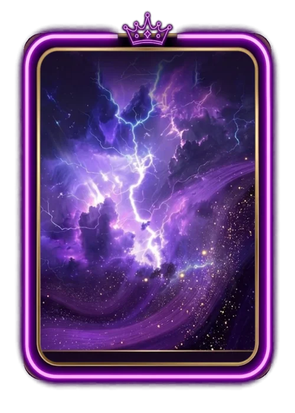

# Time do Mês

> Ficha gerada de `docs/cartas/catalogo.json` por `scripts/cartas/gerar-catalogo.py`. Edite o JSON, não este arquivo.

| | |
| --- | --- |
| Chave | `premio-time-do-mes` |
| Tipo | visual de prêmio |
| Raridade | — |
| Onde aparece | prêmio do mês |
| Evento | — |
| Nível e preço | — |
| Estado | no app |
| Roupa no código | `MONTH_ROUPA` em `components/cancha-card.tsx` |

## Montada

## Arquivos no app (`public/cartas/fundos/`)

- Fundo: `premium-time-do-mes.webp`
- Moldura e o que vaza: `premium-time-do-mes-vaza.webp`

## Peças originais (do Gemini, como o dono mandou)

- `docs/superpowers/specs/2026-10-28-cartas-assets/prototipos/time-do-mes-v4-composto-dono.jpg`
- `docs/superpowers/specs/2026-10-28-cartas-assets/prototipos/time-do-mes-fundo-dono.jpg`
- `docs/superpowers/specs/2026-10-28-cartas-assets/prototipos/time-do-mes-borda-dono.jpg`
- `docs/superpowers/specs/2026-10-28-cartas-assets/prototipos/time-do-mes-render-dono.jpg`

## Scripts

- `docs/superpowers/specs/2026-10-28-cartas-assets/prototipos/premio-time-do-mes-v4.cjs`

## Histórico

- **2026-10-21**: arte do dono, fundo roxo com pontas vazando
- **2026-10-31**: cristal roxo com coroa (as de outubro ficam assim)
- **2026-11-04**: tempestade roxa com fio de ouro, neon roxo e coroa; canto refeito espelhando

## Notas

Raios em código para vazamento foram recusados.
