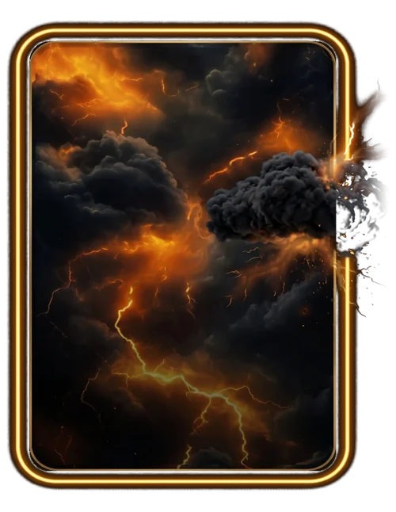

# Relâmpago

> Ficha gerada de `docs/cartas/catalogo.json` por `scripts/cartas/gerar-catalogo.py`. Edite o JSON, não este arquivo.

| | |
| --- | --- |
| Chave | `relampago` |
| Tipo | skin |
| Raridade | Épica |
| Onde aparece | Pacote (era Loja) |
| Evento | Toró (novembro de 2026) |
| Nível e preço | nível 3, 200 CC |
| Estado | no app |
| Roupa no código | `relampago` em `components/cancha-card.tsx` |

## Montada

## Arquivos no app (`public/cartas/fundos/`)

- Fundo: `premium-relampago.webp`
- Moldura e o que vaza: `premium-relampago-vaza.webp`
- Raios que acendem: `premium-relampago-raios-dentro.webp`, `premium-relampago-raios.webp`

## Peças originais (do Gemini, como o dono mandou)

- `docs/superpowers/specs/2026-10-28-cartas-assets/prototipos/premium-relampago-dono.jpg`
- `docs/superpowers/specs/2026-10-28-cartas-assets/prototipos/relampago-arte-dono.jpg`

## Scripts

- `docs/superpowers/specs/2026-10-28-cartas-assets/prototipos/premium-relampago.cjs`

## Histórico

- **2026-10-31**: arte montada pelo dono
- **2026-11-01**: refeita com a arte dourada do Gemini ("o melhor design até aqui")
- **2026-11-11**: virou só de pacote
- **2026-11-11**: teste 3D no Blender recusado; fica como está
- **2026-11-11**: mantida com o que vaza; pela nova regra, as cartas novas não terão peça saindo da carta

## Notas

Arte numa imagem só.
