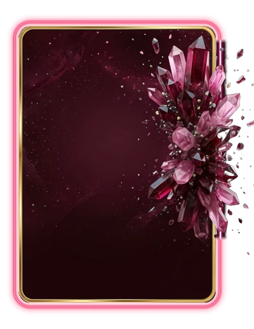

# Rubi

> Ficha gerada de `docs/cartas/catalogo.json` por `scripts/cartas/gerar-catalogo.py`. Edite o JSON, não este arquivo.

| | |
| --- | --- |
| Chave | `rubi` |
| Tipo | skin |
| Raridade | Épica |
| Onde aparece | Loja |
| Evento | — |
| Nível e preço | nível 8, 450 CC |
| Estado | no app |
| Roupa no código | `rubi` em `components/cancha-card.tsx` |

## Montada

## Arquivos no app (`public/cartas/fundos/`)

- Fundo: `premium-rubi.webp`
- Moldura e o que vaza: `premium-rubi-vaza.webp`

## Peças originais (do Gemini, como o dono mandou)

- `docs/superpowers/specs/2026-10-28-cartas-assets/prototipos/premium-v2-dono.jpg`
- `docs/superpowers/specs/2026-10-28-cartas-assets/prototipos/borda-louros-dono.jpg`

## Scripts

- `docs/superpowers/specs/2026-10-28-cartas-assets/prototipos/premium-v2.cjs`
- `docs/superpowers/specs/2026-10-28-cartas-assets/prototipos/montar-carta.cjs`

## Histórico

- **2026-11-01**: recolor da arte de cristais
- **2026-11-05**: moldura fina de louros com rubis (guardada em premium-rubi-fino)
- **2026-11-09**: volta ao desenho de cristais, rosa-vinho
- **2026-11-11**: mantida com o que vaza; pela nova regra, as cartas novas não terão peça saindo da carta

## Notas

A versão de louros ficou guardada nos arquivos -fino.
