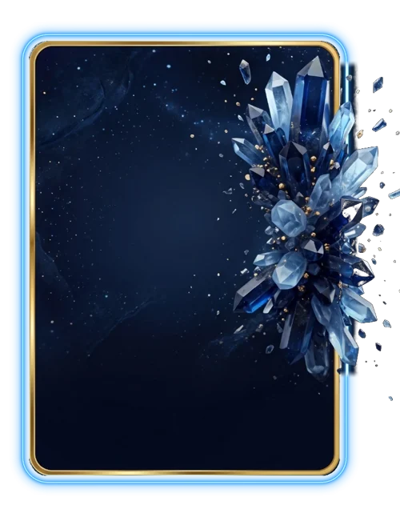

# Safira

> Ficha gerada de `docs/cartas/catalogo.json` por `scripts/cartas/gerar-catalogo.py`. Edite o JSON, não este arquivo.

| | |
| --- | --- |
| Chave | `safira` |
| Tipo | skin |
| Raridade | Épica |
| Onde aparece | Loja |
| Evento | — |
| Nível e preço | nível 4, 250 CC |
| Estado | no app |
| Roupa no código | `safira` em `components/cancha-card.tsx` |

## Montada

## Arquivos no app (`public/cartas/fundos/`)

- Fundo: `premium-safira.webp`
- Moldura e o que vaza: `premium-safira-vaza.webp`

## Peças originais (do Gemini, como o dono mandou)

- `docs/superpowers/specs/2026-10-28-cartas-assets/prototipos/premium-v2-dono.jpg`

## Scripts

- `docs/superpowers/specs/2026-10-28-cartas-assets/prototipos/premium-v2.cjs`

## Histórico

- **2026-11-01**: arte de cristais do Gemini (safira e ouro, aglomerado vazando pela direita)

## Notas

A arte original do Gemini é a da Safira.
