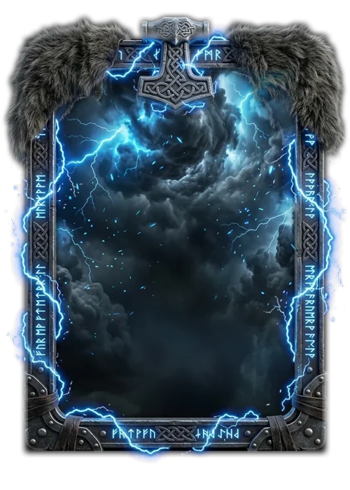

# Tormenta

> Ficha gerada de `docs/cartas/catalogo.json` por `scripts/cartas/gerar-catalogo.py`. Edite o JSON, não este arquivo.

| | |
| --- | --- |
| Chave | `tormenta` |
| Tipo | skin |
| Raridade | Lendária |
| Onde aparece | Pacote (evento Destino) |
| Evento | Destino (dezembro de 2026) |
| Nível e preço | nível 5, 600 CC |
| Estado | no app |
| Roupa no código | `tormenta` em `components/cancha-card.tsx` |

## Montada

## Arquivos no app (`public/cartas/fundos/`)

- Fundo: `premium-tormenta.webp`
- Moldura e o que vaza: `premium-tormenta-vaza.webp`
- Flutuantes: `TORMENTA_FLOATERS`

## Peças originais (do Gemini, como o dono mandou)

- `docs/superpowers/specs/2026-10-28-cartas-assets/prototipos/tormenta-fundo-dono.webp`
- `docs/superpowers/specs/2026-10-28-cartas-assets/prototipos/tormenta-borda-dono.webp`
- `docs/superpowers/specs/2026-10-28-cartas-assets/prototipos/tormenta-pecas-dono.jpg`

## Scripts

- `docs/superpowers/specs/2026-10-28-cartas-assets/prototipos/montar-carta.cjs`
- `docs/superpowers/specs/2026-10-28-cartas-assets/prototipos/tormenta-borda.cjs`
- `docs/superpowers/specs/2026-10-28-cartas-assets/prototipos/tormenta-pecas.cjs`

## Histórico

- **2026-11-09**: fundo de tempestade azul, moldura de ferro com runas, martelo e peles; raios que estalam

## Notas

Enfeites da moldura por cima do conteúdo (sem holeRect), statsLift 5.
