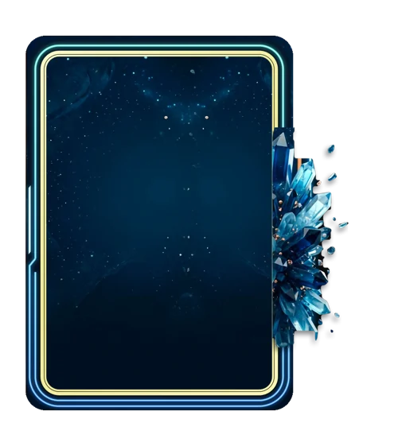

# Voltagem

> Ficha gerada de `docs/cartas/catalogo.json` por `scripts/cartas/gerar-catalogo.py`. Edite o JSON, não este arquivo.

| | |
| --- | --- |
| Chave | `voltagem` |
| Tipo | skin |
| Raridade | — |
| Onde aparece | nenhum |
| Evento | — |
| Nível e preço | — |
| Estado | guardada |
| Roupa no código | `voltagem` em `components/cancha-card.tsx` |

## Montada

## Arquivos no app (`public/cartas/fundos/`)

- Fundo: `premium-voltagem.webp`
- Moldura e o que vaza: `premium-voltagem-vaza.webp`

## Peças originais (do Gemini, como o dono mandou)

- `docs/superpowers/specs/2026-10-28-cartas-assets/prototipos/voltagem-referencia-dono.jpg`

## Scripts

- `docs/superpowers/specs/2026-10-28-cartas-assets/prototipos/voltagem.cjs`

## Histórico

- **2026-11-05**: guardada: fio duplo de ouro pálido e linhas de neon; sem nível e preço

## Notas

Para ligar: CARD_SKINS, skinRoupa e SKIN_CLASSES.
